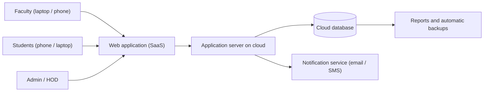

# SaaS and Cloud-Based Attendance Management System

**Name:** Gajjala Hansika
**USN:** NB25CSE119
**Assigned case study:** Question 1 – SaaS and Cloud-Based Applications

---

## Introduction

Software as a Service (SaaS) is a way of getting software where the application lives on the provider's servers in the cloud, and we just open it in a browser or a mobile app. There is nothing to install and no server to look after. The provider takes care of updates, backups and security, and the customer usually pays a subscription or a yearly fee. Gmail, Google Docs, Zoom and Microsoft 365 are the examples most of us already use every day without thinking of them as "SaaS".

This matters for a college because a department can start using a proper system without hiring a team to run servers. The college logs in and starts working.

## Problem Analysis

At the moment, attendance is first written in a paper register and then typed into an Excel sheet. It works, but it causes a lot of small problems:

- **Double work.** Faculty mark attendance once in the register and then enter the same thing again in Excel.
- **Mistakes.** Typing errors, lost pages and wrongly calculated percentages are common when everything is done by hand.
- **Late information.** Students usually find out their attendance only when someone shares the sheet, which is often when they are already close to the minimum limit.
- **Scattered files.** Sheets are saved on different laptops, and nobody is sure which one is the latest (every department has a file called "attendance_final_v2").
- **Tied to one place.** A faculty member can only update the sheet from the device that has the file.
- **Slow reports.** Getting a class-wise or subject-wise report means manually collecting and merging sheets.

## Proposed Solution

The proposal is a cloud-based attendance management system delivered as SaaS. It is a web application hosted on the cloud, so faculty, students and the admin office all use the same system through a browser, either on a laptop or on a phone. The college does not run any server of its own. It either subscribes to an existing attendance product or uses a cloud platform where the application is hosted and maintained centrally.

The basic idea is simple. A faculty member opens the class list, marks who is present or absent, and submits. The data goes straight to a central cloud database, so the student's attendance percentage updates immediately and the HOD can see the report without asking anyone for a file.

### Essential features

1. **Role-based login.** Faculty, students and admin/HOD each get their own login and see only what they need. A student can view only their own record, while faculty can edit only their own subjects.
2. **Quick attendance marking.** The class list is already loaded, so marking a full class takes about a minute. Faculty can also correct a mistake later, and the change is logged.
3. **Live attendance percentage.** Students can check subject-wise attendance on their phone at any time instead of waiting for a printed list.
4. **Alerts and notifications.** If a student's attendance falls below the college limit, the system sends an email or SMS to the student (and the mentor, if the college wants that).
5. **Reports and export.** Subject-wise, class-wise and monthly reports can be generated in a few clicks and downloaded as Excel or PDF for the office.

### Simple architecture diagram

In words: users open the web application, the application server on the cloud processes each request, the data is stored in the cloud database, and the notification service sends alerts when needed. Reports and backups are generated from the same database, so there is only one copy of the truth.

## Benefits and Challenges

### How cloud access helps faculty and students

- **Faculty** can mark or correct attendance from the classroom, the lab or even from home, and they no longer have to type everything again at the end of the day.
- **Students** can see where they stand during the semester, so they can fix a shortage in time instead of finding out at the end.

### Three benefits of cloud-based applications

1. **Access from anywhere.** All that is needed is a device and an internet connection, so the system works from any classroom, department or home.
2. **Low setup and maintenance effort.** The college does not buy or maintain servers. Updates and new features reach everyone automatically.
3. **One central, backed-up copy of the data.** Everyone sees the same up-to-date records, nothing is lost if a laptop crashes, and the system can easily handle a new batch of students.

### Two challenges

1. **Dependence on the internet.** If the Wi-Fi in a classroom is down, attendance cannot be submitted. One way to handle this is an offline mode that saves the entries on the device and syncs them once the connection is back.
2. **Data security and privacy.** Attendance records are personal student data stored outside the college, so strong login control, encryption and regular backups are important. The college also has to trust the provider to keep the service running, so it makes sense to check the provider's security and uptime before choosing one.

## Conclusion

Maintaining attendance with registers and Excel sheets wastes time and leads to errors that are easy to avoid. A SaaS-based attendance system moves everything to one place that faculty, students and the admin office can reach from anywhere. It saves effort, gives students timely information and makes reports quick. The challenges, mainly internet dependence and data security, are real but can be managed with an offline mode and good security practices. Overall, I think SaaS is a practical and sensible choice for this college.
