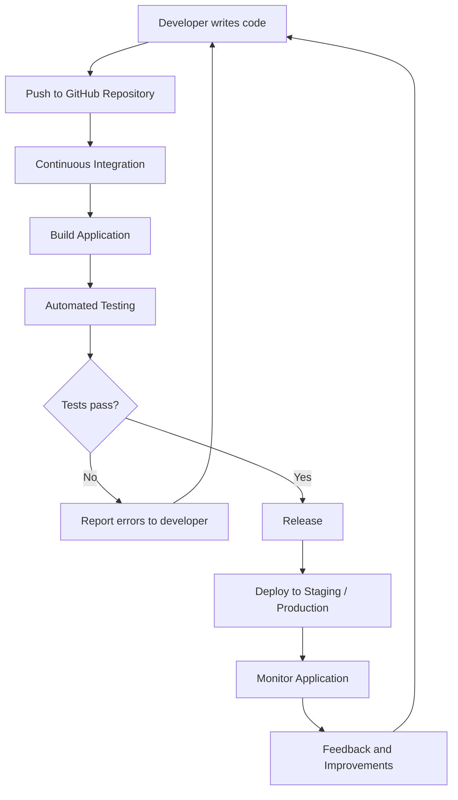

# DevOps Practices and CI/CD Pipelines

**Name:** Charan V Karad  
**USN:** NB25CSE080  
**Unit:** 5 – Case Study (Question 3)

## 1. Introduction to DevOps

DevOps is a software engineering approach that combines Development (Dev) and Operations (Ops) to improve collaboration, automate workflows, and deliver software updates faster and more reliably. It encourages continuous integration, continuous delivery, monitoring, and feedback throughout the software development lifecycle.

## 2. Case Study Problem

A software company develops an online shopping application. Developers frequently update the application to introduce new features and fix bugs. However, manual testing and deployment are causing delays and errors.

To address these issues, the company can adopt DevOps practices and implement a CI/CD pipeline to automate the development, testing, and deployment process.

## 3. Continuous Integration and Continuous Delivery/Deployment

- **Continuous Integration (CI):** Developers frequently merge their code changes into a shared repository. Each change is automatically built and tested to identify issues early.
- **Continuous Delivery (CD):** Code changes are automatically prepared and validated for release. The software remains ready for deployment, which may require approval.
- **Continuous Deployment:** Every change that passes the automated pipeline is automatically deployed to production without a manual release step.

## 4. CI/CD Pipeline Stages

1. **Code:** Developers write code and push changes to a version-control repository such as GitHub.
2. **Build:** The pipeline automatically compiles and packages the application.
3. **Test:** Automated tests check functionality and detect bugs or regressions.
4. **Release:** A validated build is prepared for release.
5. **Deploy:** The application is deployed to a staging or production environment.
6. **Monitor:** Application performance, errors, and user feedback are monitored to identify issues.

## 5. Build, Test, and Deployment

- **Build:** Converts source code into an executable or deployable package and checks whether the code can be built successfully.
- **Test:** Runs automated tests to verify that features work as expected and that new changes do not break existing functionality.
- **Deployment:** Publishes the validated application to the required environment, such as staging or production.

## 6. Benefits of Automation

- **Faster delivery:** Automated processes reduce the time required to test and release new features and bug fixes.
- **Improved quality:** Frequent automated testing helps detect errors early and reduces the chance of faulty releases.
- **Reduced manual errors:** Automation makes testing and deployment more consistent and reliable.

## 7. CI/CD Pipeline Diagram

## 8. Conclusion

By adopting DevOps practices and a CI/CD pipeline, the online shopping application company can automate its build, testing, and deployment activities. This reduces delays and manual errors, improves software quality, and enables the company to deliver new features and bug fixes more frequently and reliably.
