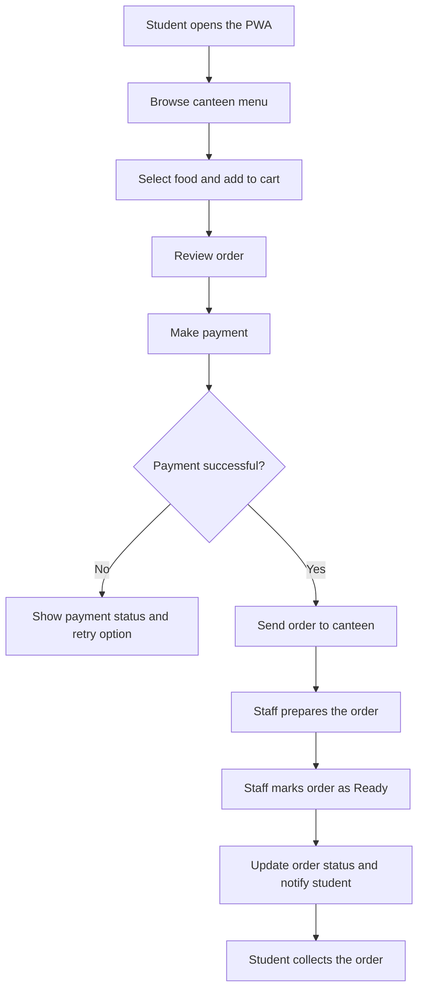

# Online Canteen Food-Ordering System

**Student Name:**  Challa Venkatesh
**USN:** NB25CSE078  
**Assigned Case Study:** Question 2 – Mobile and Web Applications Engineering  
**GitHub filename:** `NB25CSE078_Canteen_Application.md`

## 1. Introduction

A college canteen serves many students and staff members during short break periods. Manual ordering can lead to long queues, confusion about orders, delays in payment, and difficulty in knowing when food is ready. An online canteen food-ordering system can make this process easier. Users can view the menu, select food items, place orders, make payments, and receive a notification when their order is ready.

A **mobile application** is installed on a smartphone. A **web application** is accessed through a web browser. A **Progressive Web Application (PWA)** is a web application that uses modern browser features to provide an app-like experience. A PWA can be installed on supported devices and can use caching and notifications where supported and permitted.

## 2. Problem Analysis

The college wants a convenient system through which students can browse the canteen menu, place food orders, make payments, and know when their orders are ready. The system should be easy to access and should work for students using different devices.

Main requirements:
- Display available food items, prices, and availability.
- Allow students to add items to a cart and place an order.
- Support secure payment through a suitable payment service.
- Show order status and notify students when an order is ready.
- Provide canteen staff with a way to view and update orders.

## 3. Comparison of Application Approaches

| Approach | Advantages | Limitations |
|---|---|---|
| Mobile application | App-like experience; good integration with device features; may support push notifications. | Users generally need to install it; separate Android and iOS development may increase time and cost. |
| Web application | Opens through a browser; no installation required; one application can serve many device types. | Some device features and offline capabilities may be limited; experience depends on browser and internet access. |
| Progressive Web Application (PWA) | Browser access and installability on supported devices; responsive; can cache selected content; common codebase. | Features vary by browser and operating system; notifications need support and permission; offline ordering and payment cannot be guaranteed. |

## 4. Proposed Solution: Progressive Web Application (PWA)

A **responsive PWA** is a suitable choice for the college canteen system. Students can open it using a link or QR code without first installing an application. Frequent users can add it to their device's home screen on supported devices.

A PWA can provide a common interface for Android phones, iPhones, tablets, and computers. This reduces the need to develop and maintain separate applications for each platform. An internet connection is still needed for live menu availability, order placement, payment confirmation, and current order status.

### 4.1 Major Functionalities

1. **Menu display:** Shows food names, descriptions, prices, and item availability. Staff can update the menu.
2. **Cart and order placement:** Students select items, change quantities, review the total, and submit an order.
3. **Payment processing:** Connects to a trusted payment gateway. Sensitive card details should not be stored directly by the canteen application.
4. **Order tracking and notifications:** Shows whether an order is received, being prepared, or ready. Notifications are used where supported and permitted; order status remains visible inside the application.
5. **Staff order management:** Allows canteen staff to view incoming orders and update their status.

### 4.2 Simple Application Workflow Diagram



### 4.3 High-Level System Structure

```text
Student / Canteen Staff
          |
          v
 Responsive PWA Interface
          |
          v
      Backend API
       /   |    \
      v    v     v
   Menu  Order  User/Staff
  Service Service Service
          |
          v
       Database
          |
          +------ Payment Gateway
          |
          +------ Notification Service
```

## 5. Development Challenges

1. **Payment security and reliability:** Online payments must use a trusted payment gateway. The system must verify payment results and avoid duplicate paid orders when users retry or refresh a page.
2. **Different browsers and devices:** PWA features may behave differently across browsers and operating systems. The interface must be tested on common phones, tablets, and desktop browsers.
3. **Network and notification limitations:** A weak internet connection can delay menu updates or order-status changes. Push notifications may require browser support and user permission, so students should also be able to check order status inside the application.

## 6. Benefits of the Proposed System

- Reduces physical queues because students can place orders before reaching the counter.
- Saves time for students and canteen staff.
- Makes menu items, prices, and availability easier to communicate.
- Provides clearer order tracking and reduces confusion.
- A single responsive PWA can serve different device types, reducing development and maintenance effort compared with separate platform-specific apps.

## 7. Conclusion

A Progressive Web Application is a practical approach for the college canteen food-ordering system because it combines browser access with selected app-like features. Students can browse the menu, place orders, make payments through a payment gateway, and track their orders. The system should be responsive, secure, and tested across devices. Network limitations, payment reliability, and differences in browser support must be considered during development.

## 8. GitHub Contribution Steps

1. Open the faculty repository provided by the instructor.
2. Fork the repository to the student's GitHub account.
3. Open the fork and go to the `contributions` folder.
4. Create a new file named `NB25CSE078_Canteen_Application.md`.
5. Paste this Markdown content and commit it to the fork's `main` branch.
6. Create a Pull Request from the student's fork's `main` branch to the faculty repository's `main` branch.
7. Use the title **Student Contribution – Canteen Application (NB25CSE078)**.
8. Submit the Pull Request URL as evidence after creating it.

**Important:** The Pull Request URL and merge status must be filled in only after the actual GitHub submission. They are not generated by this report.
