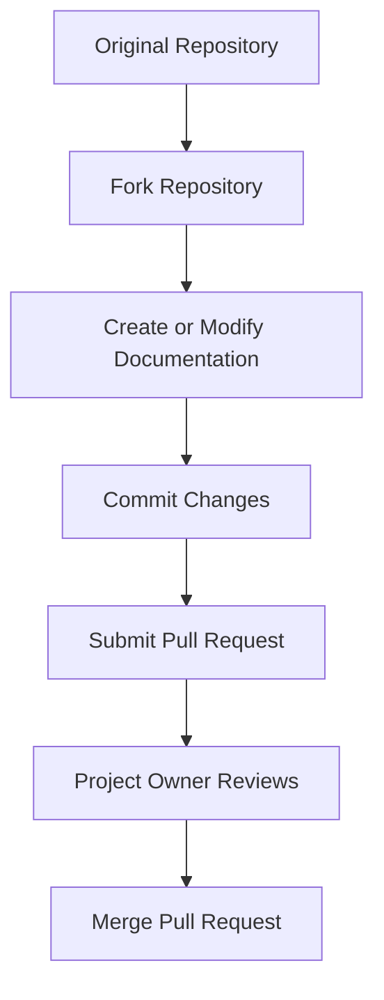

# Open-Source Software Engineering

**Name:** Dhanushree D  
**USN:** NB25CSE100  
**Case Study:** Question 4 – Open-Source Software Engineering

## 1. Introduction

Open-source software engineering is the process of developing software whose source code is publicly available. Developers can access, use, modify and contribute to the software. GitHub is one of the popular platforms used for open-source collaboration.

## 2. Problem Analysis

In the given case study, a group of developers is working on an open-source Library Management System hosted on GitHub. A student identifies that the project lacks proper documentation explaining how users can issue and return books.

This creates confusion for users. Therefore, the student wants to improve the documentation by providing clear instructions for issuing and returning books.

## 3. Proposed Solution

The student can contribute to the project by following these steps:

### Step 1: Fork the Repository
The student visits the original GitHub repository and clicks the Fork option. This creates a personal copy of the project.

### Step 2: Create or Modify Documentation
The student opens the repository and creates or modifies a Markdown file explaining the procedures for issuing and returning books.

### Step 3: Commit Changes
After completing the documentation, the student saves the changes by committing them with a meaningful commit message.

### Step 4: Submit a Pull Request
The student creates a Pull Request (PR) to propose the changes to the original repository. The project owner reviews the changes and merges them if they are suitable.

## 4. GitHub Contribution Workflow

## 5. Benefits of Collaborative Software Development

1. **Knowledge Sharing:** Developers learn from each other's work.
2. **Collaboration:** People from different locations can work together.
3. **Improved Software Quality:** Contributions help identify and fix problems.
4. **Skill Development:** Students gain practical experience with GitHub.
5. **Better Documentation:** Clear documentation makes software easier to understand and use.

## 6. Challenges

1. Understanding an existing project's structure may take time.
2. Changes must be reviewed carefully to avoid errors or conflicts.

## 7. Conclusion

Open-source software engineering encourages collaboration, innovation and knowledge sharing. By forking a repository, modifying documentation, committing changes and submitting a Pull Request, students can contribute effectively to software projects. This process also helps students develop practical software engineering skills.
