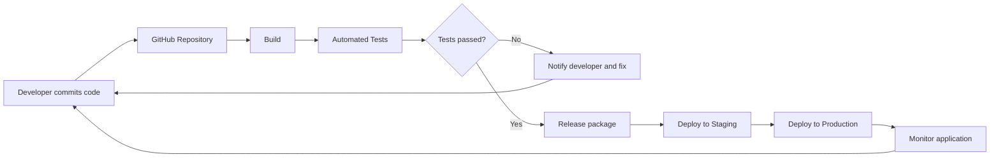

# DevOps Practices and CI/CD Pipeline for an Online Shopping Application
 
**Name:** Dhathri M
**USN:** NB25CSE101
**Case Study:** Question 3 – DevOps Practices and CI/CD Pipelines
 
---
 
## 1. Introduction
 
**DevOps** is a set of practices that combines **Development (Dev)** and **Operations (Ops)** teams. Its goal is to build, test and release software faster and more reliably. It focuses on teamwork, automation, continuous testing and continuous monitoring.
 
### Continuous Integration (CI)
Developers merge their code into a shared repository frequently, often many times a day. Every merge automatically triggers a build and tests, so errors are found early.
 
### Continuous Delivery (CD)
After the code passes all tests, it is automatically prepared for release. A person approves the final release to production.
 
### Continuous Deployment (CD)
This goes one step further. Every change that passes all tests is deployed to production automatically, with no manual approval.
 
## 2. Problem Analysis
 
A company develops an online shopping application and releases new features and bug fixes frequently. The current process has these problems:
 
- **Manual testing** is slow and testers can miss bugs.
- **Manual deployment** takes a lot of time and often goes wrong.
- Bugs reach customers because problems are found late.
- Releases are delayed and developers wait on each other.
The company needs an automated process that makes releases fast, safe and repeatable.
 
## 3. Proposed Solution
 
### 3.1 DevOps Practices Applied
 
- **Version control (Git/GitHub):** All code is stored in one shared repository.
- **Automation:** Build, test and deployment run without manual work.
- **Continuous monitoring:** The live application is watched for errors and slowness.
- **Collaboration:** Developers and operations share responsibility for the product.
### 3.2 CI/CD Pipeline Stages
 
1. **Source:** A developer commits code to GitHub. This triggers the pipeline.
2. **Build:** The code is compiled and packaged, for example into a Docker image.
3. **Test:** Automated unit, integration and security tests run. If any test fails, the pipeline stops and the developer is notified.
4. **Release:** The tested package is stored and prepared for deployment (Continuous Delivery).
5. **Deploy:** The application is released to a staging server first, then to production (Continuous Deployment).
6. **Monitor:** Logs and performance are tracked, and issues are fed back to developers.
### 3.3 Build, Test and Deployment Explained
 
- **Build:** The source code is converted into a runnable application, and the dependencies it needs are installed. This guarantees that the code works in a clean environment, not only on one developer's laptop.
- **Test:** Automated tests check that features like cart, payment and login still work after each change. Bugs are caught within minutes instead of days.
- **Deployment:** The tested application is automatically pushed to servers. If something goes wrong, the pipeline can **roll back** to the last working version.
### 3.4 CI/CD Pipeline Diagram
 

 
## 4. Benefits and Challenges
 
### Three Benefits of Automation
 
1. **Faster releases:** New features and bug fixes reach customers in hours instead of days or weeks.
2. **Fewer errors:** Automated tests and deployment remove human mistakes, so the quality of the application improves.
3. **Early bug detection:** Every code change is tested immediately, so bugs are cheaper and easier to fix.
### Challenges
 
- Setting up the pipeline takes time and skilled people.
- Automated tests must be written and kept up to date.
- Tools such as Jenkins, GitHub Actions or Docker have a learning curve for the team.
## 5. Conclusion
 
Manual testing and deployment cause delays and errors in the online shopping application.
A CI/CD pipeline built on DevOps practices automates the build, test and deployment stages. 
This makes releases faster, more reliable and less stressful for the team.
The company can deliver new features and fixes to customers quickly while keeping quality high.
 
