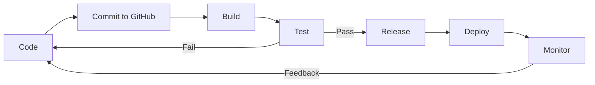

# DevOps Practices and CI/CD Pipelines

**Name:** G S Koushik
**USN:** NB25CSE113
**Assigned Case Study:** Question 3 – DevOps Practices and CI/CD Pipelines

---

## 1. Introduction to DevOps

DevOps comes from two words: **Development (Dev)** and **Operations (Ops)**. It is a way of working in which the people who write the software and the people who run it on servers work as one team instead of separate groups.

DevOps is based on automation, shared responsibility, quick feedback and small, frequent releases.

**Case study problem:** An online shopping company keeps updating its app with new features (offers, wishlist, delivery tracking) and bug fixes. Because testing and deployment are done by hand, every release is slow and mistakes reach customers. DevOps solves this by automating these steps.

---

## 2. Meaning of Continuous Integration and Continuous Delivery/Deployment

**Continuous Integration (CI):**
- Every developer merges code into the main GitHub repository many times a day.
- Each merge automatically starts a build and runs the tests.
- Mistakes and merge conflicts are found within minutes, not weeks later.

**Continuous Delivery (CD):**
- Code that passes CI is automatically packaged and kept ready to release at any time.
- Sending it to the live server needs one manual approval (a button click).

**Continuous Deployment:**
- Code that passes every automated check goes to the live server automatically.
- There is no manual approval step.

---

## 3. CI/CD Pipeline Stages

1. **Plan & Code:** The team decides on a change (e.g. a "Buy Now" button) and developers write it.
2. **Commit:** Code is pushed to GitHub, which triggers the pipeline automatically.
3. **Build:** A CI tool (GitHub Actions / Jenkins) compiles the code and creates a package.
4. **Test:** Automated unit, integration and UI tests run on the new build.
5. **Release:** The tested build is stored as a version-numbered package (e.g. Docker image) ready for release.
6. **Deploy:** The package is put on a staging server first, then on the live (production) server.
7. **Monitor:** Tools watch errors, speed and failed payments, and send feedback to developers.

---

## 4. Explanation of Build, Test and Deployment

**Build:**
- Turns source code into a working application package.
- Runs on a clean server every time, so all builds are the same.
- Example: after adding a "Buy Now" button, a new version of the shopping app is built automatically.

**Test:**
- Runs test cases without a human tester.
- Checks important features: sign-up, search, add to cart, coupon discount and checkout.
- If any test fails, the pipeline stops and the developer is told immediately.

**Deployment:**
- Copies the tested version to the servers using scripts, not manual steps.
- Can update the app with no downtime and roll back to the old version if a problem appears.
- Example: customers see the new "Buy Now" button within minutes of the code being approved.

---

## 5. Three Benefits of Automation

1. **Speed:** Updates reach customers in minutes or hours instead of days, because no one waits for manual testing or deployment.
2. **Fewer Mistakes:** The same automated steps run every time, so forgotten steps and wrong settings are avoided, and bugs are caught before release.
3. **Reliability:** Small, frequent releases with quick rollback keep the shopping site stable and customers happy.

---

## 6. CI/CD Pipeline Diagram



**Pipeline Flow:**

```
    CODE
      |
      v
    COMMIT (GitHub)
      |
      v
    BUILD
      |
      v
    TEST ----(fail)----> back to CODE
      |
    (pass)
      v
    RELEASE
      |
      v
    DEPLOY
      |
      v
    MONITOR
      |
      v
  Feedback ------------> back to CODE
```

---

## Conclusion

Manual testing and deployment were slowing down the online shopping application and causing errors. Using DevOps and a CI/CD pipeline, every change is built, tested, released, deployed and monitored automatically. This gives the company faster updates, fewer errors and a more reliable application for its customers.
