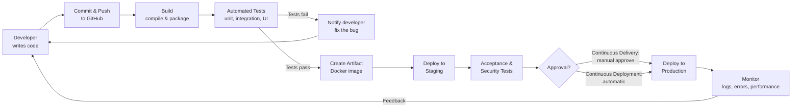

# DevOps Practices and CI/CD Pipelines

## 1. Title and Student Details

| Field | Details |
|-------|---------|
| **Name** | G S Koushik |
| **USN** | NB25CSE113 |
| **Assigned Case Study** | Question 3 – DevOps Practices and CI/CD Pipelines (Online Shopping Application) |

---

## 2. Introduction

### What is DevOps?

**DevOps** is a set of practices, tools and a culture that brings software **Development (Dev)** and IT **Operations (Ops)** teams together. Instead of developers writing code and "throwing it over the wall" to an operations team, both groups share responsibility for building, testing, releasing and running the software.

The main goals of DevOps are to:

- Deliver new features and bug fixes **faster and more often**
- Improve **software quality and reliability**
- **Automate** repetitive manual tasks such as building, testing and deploying
- Get **quick feedback** from tests and from real users

Key DevOps practices include version control, automated testing, Continuous Integration, Continuous Delivery/Deployment, Infrastructure as Code, and continuous monitoring.

### Meaning of CI and CD

| Term | Meaning |
|------|---------|
| **Continuous Integration (CI)** | Developers merge (integrate) their code changes into a shared repository frequently, often several times a day. Every change automatically triggers a **build** and a set of **automated tests**, so integration errors are found early. |
| **Continuous Delivery (CD)** | Every change that passes CI is automatically prepared and kept in a **deployable state**. Release to production is done with a **single manual approval** (a button click). |
| **Continuous Deployment (CD)** | Goes one step further: every change that passes all automated tests is **deployed to production automatically**, without any manual step. |

---

## 3. Problem Analysis

A software company develops an **online shopping application** (product catalogue, cart, payments, order tracking). Developers frequently update it with new features and bug fixes, but the current process is manual:

| Problem in Current Process | Effect |
|----------------------------|--------|
| Code from many developers is merged only occasionally | Large, painful merges and "it works on my machine" conflicts |
| Testing is done manually by testers | Slow, repetitive, and some test cases get skipped |
| Builds are prepared by hand | Different builds on different machines; missing files or wrong versions |
| Deployment to servers is done manually | Human errors (wrong config, missed step), downtime during release |
| Releases happen rarely and in big batches | Bugs reach customers, and it is hard to find which change caused a failure |
| No quick rollback | A failed release can stop customers from shopping and cause revenue loss |

**Root cause:** the build–test–deploy process depends on people doing repetitive steps by hand. This causes **delays** and **errors**.

---

## 4. Proposed Solution – DevOps with a CI/CD Pipeline

The company should adopt DevOps practices and set up an automated **CI/CD pipeline** using tools such as **Git/GitHub** (version control), **GitHub Actions or Jenkins** (pipeline automation), **JUnit/Selenium** (testing), **Docker** (packaging), **Kubernetes/AWS** (deployment) and **Prometheus/Grafana** (monitoring).

### 4.1 CI/CD Pipeline Diagram



Text version of the same pipeline:

```
 Code --> Commit --> Build --> Test --> Package --> Staging --> Production --> Monitor
   ^                            |                                                 |
   |<------ fail: notify -------|                                                 |
   |<------------------------------ feedback ------------------------------------|
```

### 4.2 CI/CD Pipeline Stages

| # | Stage | What Happens in the Shopping Application |
|---|-------|------------------------------------------|
| 1 | **Source / Commit** | A developer adds a feature (e.g. "apply discount coupon") on a branch and pushes it to GitHub. A Pull Request is opened and reviewed. The push automatically **triggers** the pipeline. |
| 2 | **Build** | The CI server checks out the code, installs dependencies, and compiles/packages the application (e.g. `mvn package` or `npm run build`). If the build fails, the pipeline stops and the developer is notified. |
| 3 | **Test** | Automated tests run: **unit tests** (cart total, coupon logic), **integration tests** (cart ↔ payment service), and **UI tests** (Selenium checkout flow). Code-quality and security scans can also run here. |
| 4 | **Package / Artifact** | The tested build is packaged as a versioned **Docker image** and stored in a registry, so the *same* artifact is used in every environment. |
| 5 | **Deploy to Staging** | The image is deployed automatically to a **staging** server that is a copy of production. Acceptance tests and performance tests run here. |
| 6 | **Deploy to Production** | In **Continuous Delivery**, a release manager approves with one click. In **Continuous Deployment**, it goes live automatically. Strategies like **blue-green** or **canary** releases avoid downtime and allow instant **rollback**. |
| 7 | **Monitor & Feedback** | Tools track errors, response time and failed payments. Alerts and user feedback go back to developers, starting the next cycle. |

### 4.3 Explanation of Build, Test and Deployment

**Build**
- Converts source code into a runnable application.
- Done automatically on a clean server for **every commit**, so builds are consistent and repeatable.
- Example: compiling the Java backend and bundling the React frontend into a Docker image.

**Test**
- Automated test suites check that new code works and has not broken existing features (**regression testing**).
- Example: a unit test confirms that a 10% coupon on ₹1,000 gives a total of ₹900; a Selenium test confirms a user can add an item to the cart and check out.
- If any test fails, the change is **blocked** from moving forward.

**Deployment**
- Moves the tested artifact to staging and then to production using scripts instead of manual steps.
- Configuration is kept in code (**Infrastructure as Code**, e.g. Terraform, Kubernetes YAML), so every environment is set up the same way.
- If a problem appears after release, the pipeline can **roll back** to the previous version in minutes.

### 4.4 Sample Pipeline Configuration (GitHub Actions)

```yaml
name: Shopping-App CI/CD
on:
  push:
    branches: [ main ]
jobs:
  build-test-deploy:
    runs-on: ubuntu-latest
    steps:
      - uses: actions/checkout@v4          # 1. Get source code
      - name: Build
        run: npm install && npm run build  # 2. Build
      - name: Run tests
        run: npm test                      # 3. Automated tests
      - name: Build Docker image
        run: docker build -t shop-app:${{ github.sha }} .   # 4. Package
      - name: Deploy to staging
        run: ./scripts/deploy.sh staging   # 5. Deploy
```

---

## 5. Benefits and Challenges

### Benefits of Automation

1. **Faster releases** – Changes move from commit to production in minutes or hours instead of weeks, so new shopping features and bug fixes reach customers quickly.
2. **Fewer errors and higher quality** – Every change is built and tested the same way, automatically. Bugs are caught early, when they are cheapest to fix, and human mistakes in manual deployment are removed.
3. **Reliable, low-risk deployments** – Small, frequent releases with automatic rollback mean that if something breaks, it is easy to find the cause and restore the previous version, reducing downtime and lost sales.

Additional benefits: better collaboration between Dev and Ops teams, quick feedback for developers, and more time for developers to build features instead of doing repetitive tasks.

### Challenges / Limitations

- **Initial setup cost and effort** – Designing the pipeline, writing automated tests and learning tools takes time and money.
- **Cultural change** – Teams must move from separate Dev and Ops roles to shared responsibility.
- **Test maintenance** – Automated tests must be kept up to date; poor or "flaky" tests reduce trust in the pipeline.
- **Security** – Secrets (payment API keys, passwords) used by the pipeline must be stored and managed securely.

---

## 6. Conclusion

The online shopping company's delays and errors come from manual integration, testing and deployment. By adopting **DevOps** and an automated **CI/CD pipeline**, every code change is automatically **built, tested, packaged, deployed and monitored**. Continuous Integration catches problems early, and Continuous Delivery/Deployment makes releases fast, consistent and easy to roll back. Although the setup requires effort and a change in team culture, automation lets the company deliver new features **faster, more reliably and with fewer errors**, giving customers a better shopping experience.

---

### References

- Ian Sommerville, *Software Engineering*, 10th Edition – Chapter on DevOps and Code Management
- GitHub Actions Documentation – https://docs.github.com/actions
- Atlassian – Continuous Integration vs Delivery vs Deployment – https://www.atlassian.com/continuous-delivery
