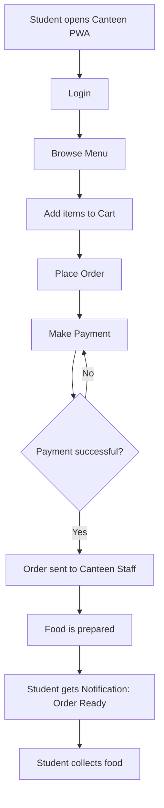

# Online Canteen Food-Ordering System
 
**Name:** Haripriya K
**USN:** NB25CSE136
**Case Study:** Question 2 – Mobile and Web Applications Engineering
 
---
 
## 1. Introduction
 
A **mobile application** is installed on a phone from an app store (for example, Android or iOS apps). 
A **web application** runs in a browser and needs no installation (for example, a college portal). 
A **Progressive Web Application (PWA)** is a web application that behaves like a mobile app. 
It can be installed on the home screen, works with a poor connection, and can send push notifications.
 
## 2. Problem Analysis
 
A college wants an online canteen system where students can:
 
- Browse the menu
- Place orders
- Make payments
- Get a notification when the order is ready
Currently, students stand in long queues, orders are taken manually, and they have to keep checking whether the food is ready.
The college needs a system that is easy to use, works on any phone, and is cheap to build and maintain.
 
## 3. Proposed Solution
 
### 3.1 Comparison of Mobile, Web and PWA
 
| Feature | Mobile App | Web App | PWA |
|---|---|---|---|
| Installation | Needed (app store) | Not needed | Optional ("Add to Home Screen") |
| Works on all devices | No, separate Android and iOS apps | Yes | Yes |
| Development cost | High | Low | Low to medium |
| Push notifications | Yes | Limited | Yes |
| Offline support | Yes | No | Yes (limited) |
| Updates | User must update | Instant | Instant |
 
### 3.2 Selected Application Type: PWA
 
A **Progressive Web Application** is the most suitable choice because:
 
1. **One codebase for all devices.** Students use different phones, and one PWA works on all of them.
2. **No app-store installation.** Students open the link and add it to the home screen.
3. **Push notifications.** It can alert the student when the order is ready.
4. **Low cost.** The college does not need to build and maintain separate Android and iOS apps.
5. **Easy updates.** When the menu or features change, everyone gets the new version immediately.
### 3.3 Four Major Functionalities
 
1. **Menu browsing:** View items, prices and availability, with categories and search.
2. **Order placement:** Add items to the cart, choose a pickup time and confirm the order.
3. **Online payment:** Pay through UPI, card or wallet, and receive a digital receipt.
4. **Order notification:** The student gets an alert when the order is ready for pickup.
### 3.4 Application Workflow Diagram
 

 
## 4. Benefits and Challenges
 
### Expected Benefits
 
- Shorter queues and less waiting time
- Fewer manual errors in orders
- Cashless payments with digital records for the canteen
### Three Development Challenges
 
1. **Secure payments:** Payment gateway integration must protect student data and handle failed or duplicate payments.
2. **Real-time updates and notifications:** Menu availability and order status must update instantly. Push notifications can be limited on some browsers, especially older iPhones.
3. **Handling peak load:** Many students order at the same time during breaks, so the system must stay fast and not crash.
## 5. Conclusion
 
An online canteen system will save students' time and make canteen operations more organized. 
Comparing mobile, web and PWA approaches, a **PWA** is the best choice because it has low cost, works on every device, supports notifications and is easy to update.
With proper attention to payment security and peak-time performance, the system can be developed successfully for the college.
 
