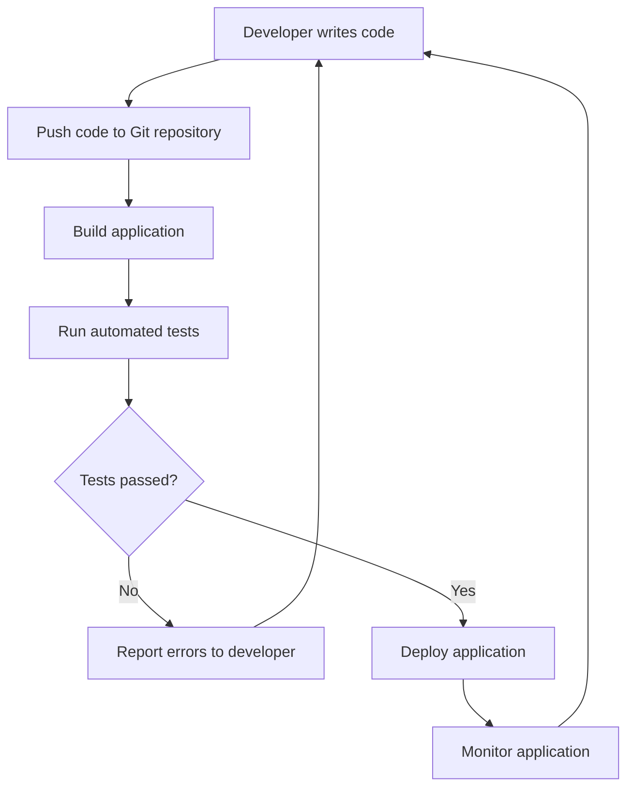

# DevOps Practices and CI/CD Pipelines

## Student Details

- **Name:** Harsh Raj
- **USN:** NB25CSE138
- **Case Study:** Question 3 – DevOps Practices and CI/CD Pipelines

## 1. Introduction

DevOps is a software engineering approach that brings development and operations teams together. Its main aim is to develop, test, and deliver software faster and more reliably through teamwork, automation, and continuous improvement.

Continuous Integration (CI) is the practice of regularly combining developers' code changes into a shared repository. Each change can automatically trigger a build and tests to identify errors early.

Continuous Delivery/Deployment (CD) automates the process of preparing and releasing software. In Continuous Delivery, the application is kept ready for release, while Continuous Deployment can automatically release changes to users after all required checks pass.

## 2. Problem Analysis

The company is developing an online shopping application. Developers frequently add new features and fix bugs. However, manual testing and deployment are causing delays and errors.

The main problems are:

- Testing every update manually takes a lot of time.
- Errors may be discovered late in the development process.
- Manual deployment can lead to mistakes.
- Releasing new features and bug fixes becomes slow.

Therefore, the company needs an automated process to build, test, and deploy the application.

## 3. Proposed Solution: DevOps and CI/CD Pipeline

The company can use DevOps practices and a CI/CD pipeline to automate the software development and release process.

### CI/CD Pipeline Stages

1. **Code:** Developers write code and push their changes to a shared Git repository.
2. **Build:** The CI tool automatically compiles the code and creates a build of the application. It also checks for basic build errors.
3. **Test:** Automated tests are run to check whether the application works correctly and whether new changes have caused problems.
4. **Deploy:** After the required checks pass, the application is deployed to a staging or production environment, depending on the release process.
5. **Monitor:** The team monitors the application to identify errors and performance issues. Feedback is used to improve future updates.

### Explanation of Build, Test, and Deployment

- **Build:** Converts the source code into a usable application package and checks whether the code can be built successfully.
- **Test:** Runs automated tests to find bugs and verify that the features work as expected.
- **Deployment:** Makes the tested application available in the required environment so that users can access the latest version.

### Simple CI/CD Pipeline Diagram

## 4. Benefits of Automation

1. **Faster delivery:** Automated building, testing, and deployment reduce the time needed to release updates.
2. **Early error detection:** Automated tests help identify bugs soon after code changes are made.
3. **Fewer manual mistakes:** Automation makes the release process more consistent and reduces errors caused by manual work.

## 5. Challenges

1. **Initial setup:** Setting up the CI/CD tools, pipeline, and deployment environments may require time and technical knowledge.
2. **Maintaining automated tests:** Tests must be updated whenever the application changes. Poorly maintained tests may give incorrect results or miss bugs.

## 6. Conclusion

DevOps practices and a CI/CD pipeline can help the company improve the development of its online shopping application. By automating the build, testing, and deployment stages, the company can release updates faster, detect errors early, and reduce manual mistakes. This makes software delivery more reliable and efficient.
